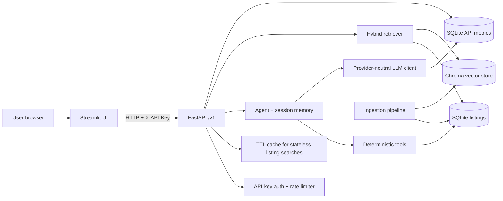

# Architecture

The application separates the agent, deterministic calculations, retrieval,
API, and Streamlit UI into independently replaceable components.

## Runtime architecture

The UI communicates with the backend over HTTP only. Provider SDKs are
isolated behind `agent/llm.py`; API monitoring stores operational data in a
separate SQLite database.

## Agent turn

`Agent.chat` loads a session snapshot, asks `Planner` for ordered allow-listed
tool calls, validates numeric tool inputs against the user's request or
verified session context, executes deterministic tools, and sends the current
request with tool outputs to the LLM for wording. The final reply is checked by
`verify_numeric_claims`; one regeneration is attempted before an unsupported
numeric reply is rejected. Provider-specific SDK code is isolated in
`agent/llm.py`, selected through `LLM_PROVIDER`, `LLM_API_KEY`, and `LLM_MODEL`.
Groq uses the OpenAI-compatible Chat Completions adapter pointed at
`https://api.groq.com/openai/v1`.

## Data and retrieval

1. `rag.ingest.ingest_data` validates each CSV row with the shared `Listing`
   Pydantic model. Invalid rows are logged and skipped; valid rows are upserted
   into `data/processed/listings.db`.
2. Listing descriptions and chunked Markdown area/developer references are
   embedded and stored in the persistent Chroma collection
   `data/processed/chroma`.
3. `HybridRetriever` applies exact filters (price, area, city, bedrooms,
   delivery date, developer, and property type) in SQLite before requesting
   semantically ranked Chroma results. Listing hits are limited to the SQL
   candidate IDs. Area-guide and developer hits carry their original source
   paths for attribution.
4. `agent.tools.search_listings.search_listings` exposes these attributed
   results to the assistant layer.

## Deterministic tools

- `installment_calc` calculates equal-principal monthly installments at zero
  interest and amortized mortgage payments for positive annual rates.
- `roi_estimator` uses caller-supplied rent, appreciation, and horizon inputs;
  its result includes those assumptions and the model's exclusions.
- `compare_plans` compares already calculated plans, optionally associated
  with source listings. It does not infer missing financing terms from a raw
  listing.
- `save_search` validates preferences and stores them in thread-safe,
  process-local session memory.

## Local workflow

Copy `.env.example` to `.env`, configure `API_KEY` and the selected LLM
provider, then install `requirements.txt`. Run `python -m rag.ingest` before
starting the API. Start the API with `uvicorn api.main:app --reload` and the UI
with `streamlit run ui/app.py`. Chroma uses its bundled local embedding
function; the model is downloaded and cached on first use.
